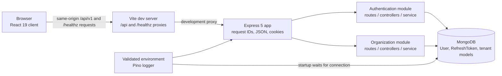

# Architecture (implemented state)

The canonical project root is the directory containing `package.json`, `.git`,
`client/`, `server/`, and `docs/`. npm workspace commands should be run from
this directory.

ResolveHQ currently consists of a React/Vite single-page client and an Express
API. The API is organized as a modular monolith with authentication and
organization endpoints. Organization creation and membership-scoped tenant
resolution establish the first tenant workflow; invitations and the
product-management modules shown in the original blueprint remain future work.

## Components and request flow



In development, Vite forwards `/api` and `/healthz` to
`http://localhost:4000`. The API app
module is separate from startup: `server/src/app.js` configures HTTP middleware
and routes without opening a database connection. `server/src/server.js`
validates configuration, connects to MongoDB before listening, and handles
SIGINT/SIGTERM by closing the HTTP server and disconnecting the database.
`GET /healthz` returns `{ "status": "ok" }`; it is not a database health check.

## Authentication and session lifecycle

```mermaid
sequenceDiagram
  participant B as Browser / client
  participant A as Express API
  participant D as MongoDB
  B->>A: POST /auth/register or /auth/login
  A->>D: Validate user / verify password; persist refresh-token hash
  A-->>B: Access token + public user; Secure HttpOnly refresh cookie
  Note over B: Access token stays in memory; cookie is not readable by client JS
  B->>A: Authenticated API request with Bearer access token
  A->>D: Verify active user and token version
  A-->>B: Protected response
  B->>A: POST /auth/refresh with cookie and exact Origin
  A->>D: Validate, revoke old token, persist replacement
  A-->>B: New access token + rotated refresh cookie
```

Registration and login return an access JWT and safe public user object. The
refresh token is a random opaque value; only its SHA-256 hash is stored. The
cookie is scoped to `/api/v1/auth`, is Secure, HttpOnly, SameSite=Strict, and
expires after seven days. Access JWTs use HS256 and expire after 15 minutes.
The client restores a session by refreshing and then requesting `/auth/me`;
simultaneous refresh requests share one in-flight refresh operation.

The API requires an exact `Origin` match to `CLIENT_ORIGIN` for refresh, logout,
and logout-all. Individual logout revokes the refresh token but an already
issued access JWT can remain valid until expiry. Logout-all increments the
user's token version, invalidating existing access and refresh tokens. Login
and registration limits, as well as refresh limits, use in-memory rate-limit
stores and are not distributed across processes.

After authentication, the client loads the caller's organizations. An
authenticated user with no memberships is routed to `/onboarding`; successful
organization creation gives the caller an Owner membership and proceeds to
`/app`. Existing users with memberships continue directly to `/app`.

`GET /api/v1/organizations` lists only the authenticated user's memberships.
`GET /api/v1/organizations/:organizationId` resolves the requested tenant by
querying Membership with both the caller's user ID and the requested
organization ID; inaccessible or invalid IDs return 404. The URL identifier is
never treated as authorization by itself. Authentication, membership-based
tenant resolution, and role permissions remain separate concerns.

`POST /api/v1/organizations` validates a strict `{ "name": "..." }` body,
derives the creator from `req.user`, and creates the Organization and Owner
Membership in one transaction. Slugs are normalized to URL-safe lowercase and
unique-index collisions are retried with random suffixes. The API returns
`503 TRANSACTIONS_UNAVAILABLE` when MongoDB is standalone or disconnected; it
does not fall back to nontransactional writes. The local standalone MongoDB
instance therefore cannot complete this workflow.

## Current module boundaries

```text
client/src/
  App.jsx                 Auth and initial /app routing
  auth/                   In-memory token, API client, auth context
  components/             Login, registration, onboarding, workspace shell
  routing.js              Lightweight client-side navigation

server/src/
  app.js                  Express app and HTTP middleware
  server.js               Database startup, listen, graceful shutdown
  config/                 Environment, database, structured logger
  middleware/             Authentication, tenant resolution, validation, errors
  modules/auth/            Auth routes, controllers, schemas, service, models
  modules/organizations/   Organization routes, controllers, service, models
  utils/                  API errors, RBAC permissions, transaction utility
```

MongoDB models comprise `User`, `RefreshToken`, `Organization`, `Membership`,
and `Invitation`. Organization and membership schemas establish tenant and
organization-role references; invitations store only a SHA-256 token hash,
with optional project assignments and expiry metadata. Tenant service workflows
are limited to organization listing, creation, and membership-scoped detail;
invitation workflows are not implemented.

## Operational configuration

The API reads `NODE_ENV`, `PORT` (default `4000`), `LOG_LEVEL` (default
`info`), `MONGODB_URI`, `JWT_ACCESS_SECRET`, `ACCESS_TOKEN_TTL` (fixed at
`15m`), `REFRESH_TOKEN_TTL_DAYS` (fixed at `7`), `BCRYPT_COST` (default `12`,
allowed `10`–`14` outside tests), and `CLIENT_ORIGIN`. Production requires a
valid MongoDB URI, non-placeholder secret of at least 32 characters, and valid
client origin. Test mode supplies test defaults and a lower bcrypt cost.

The client reads `VITE_APP_NAME` and `VITE_API_BASE_URL` (default `/api/v1`).
These values are public. Production hosting and same-origin reverse-proxy
configuration are not provided by this repository.

Run `npm run dev` from the canonical root to start the client and API together.
The combined command runs the API without watch mode so startup failures stop
both processes. It selects an available client port starting at `5173` and
sets the corresponding API origin for that run. For API watch mode, use
`npm run dev:client` and `npm run dev:server` in separate terminals, and set
`CLIENT_ORIGIN` to the Vite origin. The API defaults to port `4000` and must
connect to MongoDB before it listens.
Server configuration errors name invalid variables without exposing their
values; MongoDB connection errors advise checking service availability and
`MONGODB_URI`.

## Transaction infrastructure

`server/src/utils/transaction.js` checks the connected server's `hello` response
before starting a transaction. A replica-set response must include `setName`;
a sharded deployment must report `msg: "isdbgrid"`. Standalone servers are
rejected without a non-transactional fallback. The utility uses Mongoose
`withTransaction()` and ends the session in `finally`; callers must pass the
provided session explicitly to every participating query and write. Mongoose
may retry the callback for transient transaction errors, so callbacks should
contain database work only and defer external side effects until after commit.

`server/src/config/db.js` does not force or verify a topology at connection
startup. The runtime `hello` check verifies topology shape, not successful
commit behavior. Transaction tests mock sessions; actual transaction support
has not been verified against a replica set or sharded cluster. A local
standalone MongoDB instance is not sufficient.

## Scope and verification

**Implemented:** client login/registration, authenticated organization
onboarding, protected workspace shell, organization listing/creation/detail
API, membership-scoped tenant resolution, MongoDB user/session/tenant
persistence, reusable transaction utility, validation, logging, health
endpoint, rate limits, and database lifecycle.

**Tested:** mocked client auth/API behavior, backend HTTP behavior with mocked
persistence, schema and mocked transaction units, server and configuration
units, and an opt-in real-MongoDB auth suite. Transaction tests do not prove
database transaction compatibility. See [the README](../README.md) for
commands.

**Not implemented or not verified:** invitation workflows; team/project/task/
issue features; live browser-to-API end-to-end behavior; replica-set/sharded
transaction execution; production deployment, distributed rate limiting, and
the complete production security checklist.
