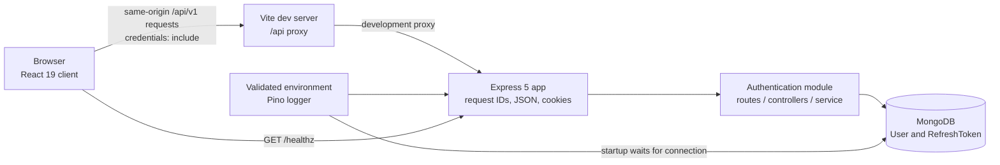

# Architecture (implemented state)

ResolveHQ currently consists of a React/Vite single-page client and an Express
API. The API is organized as a modular monolith; authentication is the only
domain module with routes and persistence models. Product-management modules
shown in the original blueprint are future work.

## Components and request flow



In development, Vite forwards `/api` to `http://localhost:4000`. The API app
module is separate from startup: `server/src/app.js` configures HTTP middleware
and routes without opening a database connection. `server/src/server.js`
validates configuration, connects to MongoDB before listening, and handles
SIGINT/SIGTERM by closing the HTTP server and disconnecting the database.
`GET /healthz` returns `{ "status": "ok" }`; it is not a database health check.

## Authentication and session lifecycle

```mermaid
sequenceDiagram
  participant B as Browser / client
  participant A as Express API
  participant D as MongoDB
  B->>A: POST /auth/register or /auth/login
  A->>D: Validate user / verify password; persist refresh-token hash
  A-->>B: Access token + public user; Secure HttpOnly refresh cookie
  Note over B: Access token stays in memory; cookie is not readable by client JS
  B->>A: Authenticated API request with Bearer access token
  A->>D: Verify active user and token version
  A-->>B: Protected response
  B->>A: POST /auth/refresh with cookie and exact Origin
  A->>D: Validate, revoke old token, persist replacement
  A-->>B: New access token + rotated refresh cookie
```

Registration and login return an access JWT and safe public user object. The
refresh token is a random opaque value; only its SHA-256 hash is stored. The
cookie is scoped to `/api/v1/auth`, is Secure, HttpOnly, SameSite=Strict, and
expires after seven days. Access JWTs use HS256 and expire after 15 minutes.
The client restores a session by refreshing and then requesting `/auth/me`;
simultaneous refresh requests share one in-flight refresh operation.

The API requires an exact `Origin` match to `CLIENT_ORIGIN` for refresh, logout,
and logout-all. Individual logout revokes the refresh token but an already
issued access JWT can remain valid until expiry. Logout-all increments the
user's token version, invalidating existing access and refresh tokens. Login
and registration limits, as well as refresh limits, use in-memory rate-limit
stores and are not distributed across processes.

## Current module boundaries

```text
client/src/
  App.jsx                 Auth and initial /app routing
  auth/                   In-memory token, API client, auth context
  components/             Login, registration, initial workspace shell
  routing.js              Lightweight client-side navigation

server/src/
  app.js                  Express app and HTTP middleware
  server.js               Database startup, listen, graceful shutdown
  config/                 Environment, database, structured logger
  middleware/             Authentication, validation, errors, 404
  modules/auth/            Auth routes, controllers, schemas, service, models
  utils/                  API error type
```

MongoDB models currently comprise `User` and `RefreshToken`. User records
contain a normalized unique email, bcrypt password hash, token version, status,
and timestamps. Refresh-token records contain the user, unique token hash,
family, token version, expiry (TTL index), and revocation time.

## Operational configuration

The API reads `NODE_ENV`, `PORT` (default `4000`), `LOG_LEVEL` (default
`info`), `MONGODB_URI`, `JWT_ACCESS_SECRET`, `ACCESS_TOKEN_TTL` (fixed at
`15m`), `REFRESH_TOKEN_TTL_DAYS` (fixed at `7`), `BCRYPT_COST` (default `12`,
allowed `10`–`14` outside tests), and `CLIENT_ORIGIN`. Production requires a
valid MongoDB URI, non-placeholder secret of at least 32 characters, and valid
client origin. Test mode supplies test defaults and a lower bcrypt cost.

The client reads `VITE_APP_NAME` and `VITE_API_BASE_URL` (default `/api/v1`).
These values are public. Production hosting and same-origin reverse-proxy
configuration are not provided by this repository.

## Scope and verification

**Implemented:** client login/registration, protected initial shell, session
restoration; auth API; MongoDB user and refresh-token persistence; validation,
logging, health endpoint, rate limits, and database lifecycle.

**Tested:** mocked client auth/API behavior, backend HTTP behavior with mocked
persistence, server and configuration units, and an opt-in real-MongoDB auth
suite. See [the README](../README.md) for commands.

**Not implemented or not verified:** organization/team/project/task/issue
features; live browser-to-API end-to-end behavior; production deployment,
distributed rate limiting, and the complete production security checklist.
