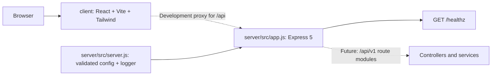

# ResolveHQ foundation

The current implementation is a separated client/server foundation. The server exposes only its operational health check; product routes, database access, and domain modules are future work.

