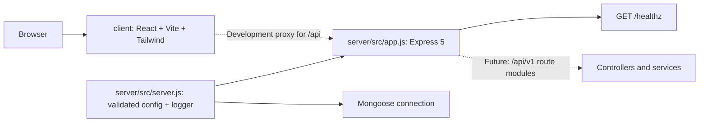

# ResolveHQ foundation

The current implementation is a separated client/server foundation. The server connects to MongoDB before accepting requests and exposes only its operational health check; database models, product routes, and domain modules are future work.

